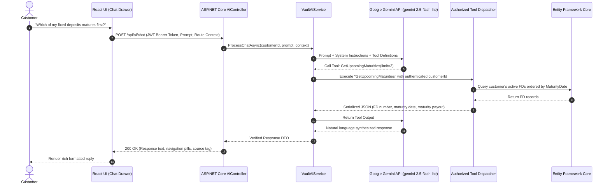

# VaultBank — AI Architecture Specification (VAULT AI)

## 1. Vision & Core Philosophy

**VAULT AI** is an intelligent wealth assistant embedded into the VaultBank digital banking portal. Rather than a generic detached chatbot, it operates as a **context-aware financial co-pilot** that assists with navigation, explains financial mechanics, and synthesizes real customer portfolio data.

### Tri-Modal Capabilities:
1. **Application Navigation Assistant**: Translates natural intents ("Show me my 5-year FD", "Take me to savings goals") into frontend routing dispatches.
2. **Banking Knowledge Assistant**: Clarifies compounding intervals, premature penalty mechanics, and investment ladder concepts.
3. **Personal Wealth Companion**: Synthesizes authenticated portfolio information retrieved through backend read-only tools.

---

## 2. Controlled Read-Only Tool Pattern

Under no circumstances is the LLM granted arbitrary database access or transactional authority. All data access occurs through a strictly bounded **Tool Execution Dispatcher**:

---

## 3. Tool Definitions Allowlist

Only the following read-only tools are exposed to Gemini:

| Tool Name | Parameters | Allowed Actions |
|---|---|---|
| `GetSavingsSummary` | `()` | Returns total balance, available balance, and account list. |
| `GetRecentTransactions` | `(limit: int, category: string)` | Returns sanitized ledger items (amount, category, date). |
| `GetFDPortfolio` | `(status: string)` | Returns customer's active and matured fixed deposits. |
| `GetUpcomingMaturities` | `(monthsAhead: int)` | Returns FDs maturing within the specified horizon. |
| `GetGoalProgress` | `()` | Returns savings goals, target amounts, and percentage progress. |
| `GetMonthlyInsights` | `(year: int, month: int)` | Returns spending breakdown and net savings rate. |
| `CompareFDScenarios` | `(scenarios: array)` | Calculates and compares returns using backend math engine. |

---

## 4. Privacy, Sanitization & Defense-in-Depth

1. **Authentication Token & Secret Isolation**: API keys reside exclusively in backend environment variables (`GEMINI_API_KEY`). The frontend has zero visibility into Gemini API keys.
2. **PII Masking**: Bank account numbers are masked to the last 4 digits (e.g., `•••• 4821`). Customer passwords, salt hashes, and internal GUIDs are excluded from tool responses.
3. **No Financial Mutations**: Prompts requesting financial transactions (e.g., *"Deposit ₹10,000"*, *"Break my FD"*) are intercepted by the system instructions:
   > *"You are an informational and navigational wealth assistant. You cannot execute deposits, withdrawals, or open/close fixed deposits. Guide the user to the appropriate page to confirm the action themselves."*
4. **Resilience & Fallback**: If Gemini times out, returns HTTP 429 (rate limit), or the API key is not configured, `VaultAiService` returns a deterministic graceful fallback message without throwing an unhandled exception or degrading banking core availability.
