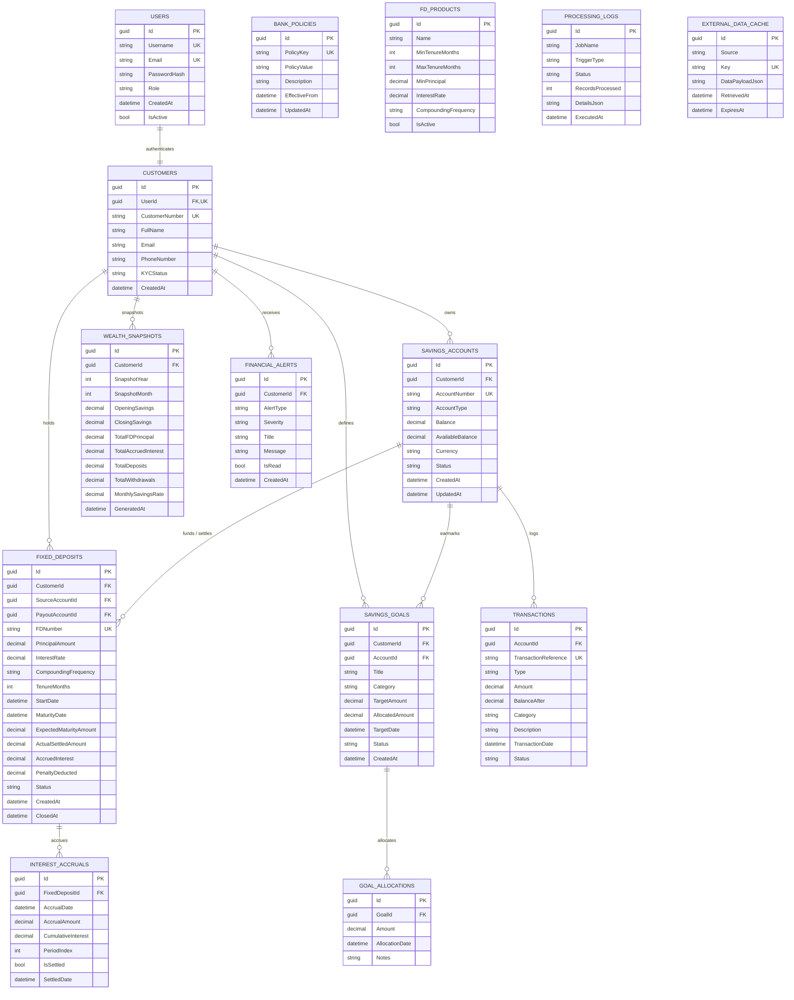

# VaultBank — Relational Database Design Specification

## 1. Schema Overview & Entity Relationships

The VaultBank database is designed for **Microsoft SQL Server** using **Entity Framework Core**, with `DECIMAL(18,2)` precision for all financial figures.



---

## 2. Table Schemas & Constraints

### 2.1 USERS & CUSTOMERS
- `Users.Role`: Constrained to `'Customer'` or `'Admin'`.
- `Customers.CustomerNumber`: Formatted as `VB-CUST-XXXXXX`, indexed and unique.

### 2.2 SAVINGS_ACCOUNTS & TRANSACTIONS
- `Balance`: Must satisfy `Balance >= 0.00` check constraint.
- `AvailableBalance`: Computed or maintained as `Balance - SUM(Active Goal Allocations)`.
- `Transactions.Type`: Enum/String: `'Deposit'`, `'Withdrawal'`, `'InterestCredit'`, `'FDFunding'`, `'FDSettlement'`, `'FDPenalty'`.
- Index on `(AccountId, TransactionDate DESC)` for fast ledger queries.

### 2.3 FIXED_DEPOSITS
- `Status`: Enforced state transitions: `'Active'` -> `'Matured'` -> `'Settled'` or `'PrematurelyClosed'`.
- `PrincipalAmount`: Minimum investment validation constraint (e.g., $\ge ₹1,000$).
- Index on `(CustomerId, Status)` and `(Status, MaturityDate)` for rapid settlement batch lookups.

---

## 3. High-Performance SQL Queries

### 3.1 Customer-Wise Deposit & Wealth Summary
```sql
SELECT 
    c.Id AS CustomerId,
    c.CustomerNumber,
    c.FullName,
    ISNULL(SUM(sa.Balance), 0.00) AS TotalSavingsBalance,
    ISNULL(SUM(sa.AvailableBalance), 0.00) AS TotalAvailableBalance,
    ISNULL(fd.TotalFDPrincipal, 0.00) AS TotalActiveFDPrincipal,
    ISNULL(fd.TotalExpectedMaturity, 0.00) AS ProjectedFDMaturityValue,
    ISNULL(SUM(sa.Balance), 0.00) + ISNULL(fd.TotalFDPrincipal, 0.00) AS TotalNetWorth
FROM Customers c
LEFT JOIN SavingsAccounts sa ON c.Id = sa.CustomerId AND sa.Status = 'Active'
LEFT JOIN (
    SELECT 
        CustomerId,
        SUM(PrincipalAmount) AS TotalFDPrincipal,
        SUM(ExpectedMaturityAmount) AS TotalExpectedMaturity
    FROM FixedDeposits
    WHERE Status = 'Active'
    GROUP BY CustomerId
) fd ON c.Id = fd.CustomerId
GROUP BY c.Id, c.CustomerNumber, c.FullName, fd.TotalFDPrincipal, fd.TotalExpectedMaturity;
```

### 3.2 Monthly Spending Category Breakdown
```sql
SELECT 
    t.Category,
    COUNT(t.Id) AS TransactionCount,
    SUM(t.Amount) AS TotalSpent,
    ROUND(SUM(t.Amount) * 100.0 / SUM(SUM(t.Amount)) OVER(), 2) AS PercentageOfTotal
FROM Transactions t
INNER JOIN SavingsAccounts sa ON t.AccountId = sa.Id
WHERE sa.CustomerId = @CustomerId
  AND t.Type = 'Withdrawal'
  AND t.TransactionDate >= @MonthStart
  AND t.TransactionDate < @MonthEnd
GROUP BY t.Category
ORDER BY TotalSpent DESC;
```

### 3.3 Upcoming FD Maturity Payouts
```sql
SELECT 
    fd.Id AS FDId,
    fd.FDNumber,
    c.FullName AS CustomerName,
    fd.PrincipalAmount,
    fd.InterestRate,
    fd.MaturityDate,
    fd.ExpectedMaturityAmount,
    DATEDIFF(day, GETUTCDATE(), fd.MaturityDate) AS DaysUntilMaturity
FROM FixedDeposits fd
INNER JOIN Customers c ON fd.CustomerId = c.Id
WHERE fd.Status = 'Active'
  AND fd.MaturityDate >= GETUTCDATE()
ORDER BY fd.MaturityDate ASC;
```
